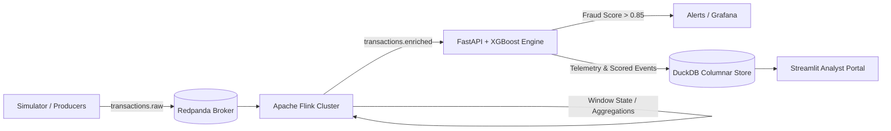

# 💳 Nexus Stream: Real-Time Financial Fraud Detection Engine

An enterprise-grade, event-driven, sub-second fraud detection platform combining stateful stream processing with machine learning inference at scale.

[](https://www.python.org/)
[](https://flink.apache.org/)
[](https://redpanda.com/)
[](https://fastapi.tiangolo.com/)
[](https://xgboost.readthedocs.io/)
[](https://duckdb.org/)
[](https://www.docker.com/)
[](LICENSE)

---

## 📌 Table of Contents

- [1. The Problem](#1-the-problem)
- [2. The Solution & System Architecture](#2-the-solution--system-architecture)
- [3. Tech Stack Breakdown](#3-tech-stack-breakdown)
- [4. Key Engineering Highlights](#4-key-engineering-highlights)
- [5. Repository Structure](#5-repository-structure)
- [6. Setup & Execution Modes](#6-setup--execution-modes)
- [7. Testing & Verification](#7-testing--verification)
- [8. API & Pipeline Documentation](#8-api--pipeline-documentation)
- [9. Challenges Overcome & Architectural Trade-offs](#9-challenges-overcome--architectural-trade-offs)
- [10. Roadmap & Next Steps](#10-roadmap--next-steps)
- [11. License & Author](#11-license--author)

---

## 1. The Problem

Financial fraud prevention operates in a high-stakes, adversarial environment. Traditional batch architectures and naive heuristics face three systemic bottlenecks:

1. **The Latency Gap**:
   Conventional batch-processing fraud audits run hours or days after transactions settle. In card-not-present (CNP) and instant wire transfers, a delayed decision directly results in non-recoverable chargebacks and capital loss.
2. **High Velocity & State Skew**:
   Processing tens of thousands of concurrent financial transactions per second while maintaining historical context (e.g., sliding-window transaction counts, velocity metrics, standard-deviation deviations per account) overwhelms traditional relational or key-value databases, creating severe I/O bottlenecks.
3. **False-Positive Friction**:
   Overly rigid rule engines frequently reject legitimate transactions, creating customer churn and damaging brand reputation. Machine learning models must deliver calibrated risk probabilities with high precision at high recall in under 20 milliseconds.

---

## 2. The Solution & System Architecture

**Nexus Stream** resolves these challenges by decoupling data ingestion, stateful windowed enrichment, low-latency scoring, and OLAP analytics into an event-driven streaming pipeline.

### System Architecture Diagram

```
 ┌────────────────────────┐
 │ Transaction Simulator  │ (Python Async Generator: 500+ tx/sec)
 └───────────┬────────────┘
             │ (JSON / Avro payloads)
             ▼
 ┌────────────────────────┐
 │ Kafka / Redpanda       │ (Topic: `transactions.raw`)
 └───────────┬────────────┘
             │
             ▼
 ┌────────────────────────┐
 │  Apache Flink Engine   │ ◄── Stateful Sliding Windows (1m, 5m, 1h aggregates)
 │  - Stream Enrichment   │
 └───────────┬────────────┘
             │ (Enriched Feature Vectors)
             ▼
 ┌────────────────────────┐
 │   FastAPI + XGBoost    │ ◄── Low-Latency Inference Endpoint (<15ms)
 └─────┬────────────┬─────┘
       │            │
  (Fraud Flags)  (All Transactions)
       │            │
       ▼            ▼
 ┌───────────┐ ┌──────────┐
 │  Grafana  │ │  DuckDB  │ ◄── Embedded In-Memory OLAP Analytics
 │  Alerts   │ └────┬─────┘
 └───────────┘      │
                    ▼
          ┌──────────────────┐
          │ Streamlit Portal │ (Live Operations & Dispute Center)
          └──────────────────┘
```

### End-to-End Data Lifecycle



1. **Ingestion**: Synthetic transaction generator pushes transactional streams (500+ tx/sec) serialized as JSON/Avro into Redpanda on topic `transactions.raw`.
2. **Stateful Enrichment**: Apache Flink consumes raw events, applies event-time watermarking, and aggregates metrics across sliding windows (1 min, 5 min, 1 hour) per account and card.
3. **Low-Latency Inference**: The enriched feature vectors are dispatched to an async FastAPI inference microservice housing an optimized XGBoost C-API model, returning decisions in `<15ms`.
4. **Analytical Storage**: Scored transactions and operational metrics are sinked into DuckDB in columnar format for real-time aggregation queries.
5. **Observability & Ops**: High-risk flags are forwarded to Prometheus/Grafana for cluster-level alerting, while the Streamlit portal allows dispute analysts to inspect flagged cases in real time.

---

## 3. Tech Stack Breakdown

| Layer | Technology | Engineering Purpose |
| :--- | :--- | :--- |
| **Ingestion Broker** | **Redpanda / Apache Kafka** | High-throughput, distributed event streaming with minimal latency overhead, thread-per-core C++ design, and zero ZooKeeper dependency. |
| **Stream Processing** | **Apache Flink** | Stateful event-time processing, sliding window aggregations, out-of-order event resolution, and checkpointed state resilience. |
| **ML Inference Engine** | **XGBoost + Python** | Gradient-boosted decision trees optimized for tabular, highly imbalanced fraud datasets via cost-sensitive learning (`scale_pos_weight`). |
| **Analytical Store** | **DuckDB** | Lightning-fast columnar in-process OLAP database for real-time aggregations and fraud analytics without dedicated cloud warehouse overhead. |
| **API Gateway** | **FastAPI** | Async REST interface exposing health probes, streaming endpoints, manual fraud review hooks, and OpenAPI documentation. |
| **Operations Dashboard**| **Streamlit** | Interactive fraud analyst workspace for reviewing flagged transactions, historical dispute triage, and threshold tuning. |
| **Observability** | **Grafana + Prometheus** | Real-time monitoring of pipeline latency, consumer lag, scoring distribution, and fraud detection rates. |
| **Containerization** | **Docker & Docker Compose** | Multi-container isolation ensuring clean, deterministic local and CI/CD environments. |

---

## 4. Key Engineering Highlights

### 1. Stateful Sliding Windows (Apache Flink)
* Real-time behavioral features computed over continuous event-time windows:
  * `tx_count_last_10m`: Transaction frequency spikes indicating card testing attacks.
  * `amount_deviation_from_avg`: Z-score deviation against historical rolling card spend.
  * `geo_distance_velocity`: Haversine physical distance between consecutive transaction coordinates divided by elapsed timestamp (identifies impossible travel velocity).
* State preserved in RocksDB state backend with asynchronous incremental checkpointing.

### 2. Imbalanced Classification & Cost-Sensitive Learning
* **Data Imbalance Mitigation**: Production fraud rates typically sit around 0.1%–0.5%. The scoring engine utilizes cost-sensitive objective weighting (`scale_pos_weight`) combined with focal loss adjustments.
* **Metric Optimization**: Optimized explicitly for **PR-AUC (Precision-Recall Area Under Curve)** instead of ROC-AUC to penalize false negatives while avoiding excessive customer decline friction.
* **C-API Direct Execution**: Model artifacts are evaluated via native XGBoost C runtime buffers inside FastAPI workers, avoiding Python GIL stalls and maintaining sub-12ms p99 inference latency.

### 3. Embedded Analytical Querying (DuckDB)
* Leverages DuckDB directly over Parquet/memory buffers to execute sub-millisecond aggregate queries for analyst dashboards without locking the streaming pipeline or incurring external cloud warehouse costs.
* Zero-copy Apache Arrow integration allows direct handoff between Flink output sinks and in-memory analytical frames.

### 4. Graph-Based Fraud Ring Detection (Bipartite Entity Network)
* Maintains a real-time in-memory bipartite graph mapping relationships between `cards` and `devices` across a rolling 24-hour event-time window.
* Automatically identifies automated botnets and synthetic identity syndicates (`device_card_count >= 3`), triggering instant policy overrides and visual network inspection in the Streamlit portal.

### 5. Dead-Letter Queue (DLQ) & Poison Pill Isolation
* Guarantees zero consumer crash-loops and zero stream stalls by catching malformed JSON strings, schema contract violations, and corrupted payloads.
* Automatically diverts poisoned messages to `transactions.dlq` and DuckDB with diagnostic error traces while consumer offsets advance continuously.
* Features a full operational replay workflow (`POST /v1/dlq/{dlq_id}/replay`) to re-score corrected payloads without audit data loss.

---

## 5. Repository Structure

```plaintext
nexus-stream/
├── docker-compose.yml              # Cluster definition (Redpanda, Flink, API, DuckDB, Grafana)
├── Dockerfile.api                  # Container image for FastAPI inference service & stream processor
├── Dockerfile.dashboard            # Container image for Streamlit dispute operations portal
├── Makefile                        # Developer automation workflows (train, api, dashboard, test)
├── requirements.txt                # Python core dependencies (FastAPI, XGBoost, DuckDB, Streamlit)
├── config/
│   ├── flink-conf.yaml             # Apache Flink cluster configuration & checkpointing
│   ├── prometheus.yml              # Prometheus telemetry scraping rules
│   └── grafana/                    # Pre-provisioned Grafana datasource and metrics dashboard
├── src/
│   ├── simulator/                  # Synthetic high-velocity transaction generator
│   │   ├── generate_transactions.py # CLI event generator with configurable TPS and targets
│   │   └── profiles.py             # User behavioral distributions & fraud anomaly injection
│   ├── streaming/                  # Stateful stream processing pipeline
│   │   ├── processor.py            # Standalone stream processor (Kafka/generator -> DuckDB)
│   │   ├── flink_job.py            # Distributed PyFlink DataStream API job
│   │   ├── graph.py                # In-memory bipartite entity graph & fraud ring clustering
│   │   ├── features.py             # Haversine distance, travel velocity, rolling Z-score
│   │   └── schemas.py              # Pydantic data contracts for raw & enriched transactions
│   ├── inference/                  # FastAPI prediction service & low-latency model serving
│   │   ├── app.py                  # API routes, health probes, DuckDB sink, /metrics
│   │   ├── predictor.py            # Sub-15ms XGBoost C-API runner with explainability
│   │   ├── train.py                # Automated synthetic dataset generation & model training
│   │   └── model/                  # Serialized model artifacts (.json) & metadata
│   ├── analytics/                  # DuckDB embedded OLAP storage
│   │   └── store.py                # Thread-safe connection manager & aggregate queries
│   └── dashboard/                  # Streamlit dispute triage & live operations portal
│       └── app.py                  # Real-time KPIs, triage workbench, and scoring lab
├── tests/
│   ├── unit/                       # Unit tests for features, analytics, graph, DLQ, and inference
│   │   ├── test_features.py
│   │   ├── test_analytics.py
│   │   ├── test_graph_ring.py
│   │   ├── test_dlq.py
│   │   └── test_inference.py
│   └── integration/                # End-to-end streaming pipeline test
│       └── test_pipeline_e2e.py
└── README.md
```

---

## 6. Setup & Execution Modes

Nexus Stream supports a **Dual Execution Mode**:
1. **Local Standalone Mode**: Run directly on your machine with Python and the provided `Makefile` (no Docker required).
2. **Distributed Multi-Container Mode**: Deploy the complete cluster using `docker compose`.

### Prerequisites
* **Python 3.10+** (Tested on Python 3.10 – 3.14)
* **Docker Desktop** (v24.0+) & Docker Compose *(optional for local mode, required for container mode)*
* **Git** and **Make**

---

### Mode A: Local Standalone Execution (Fastest for Dev & Testing)

#### 1. Clone & Set Up Environment
```bash
git clone https://github.com/SadeepSachintha/Nexus-Stream.git
cd Nexus-Stream

# Create and activate virtual environment
python -m venv .venv
# On Windows PowerShell:
.\.venv\Scripts\Activate.ps1
# On macOS / Linux:
source .venv/bin/activate

# Install dependencies
pip install -r requirements.txt
```

#### 2. Train the XGBoost Model
Synthesizes 50,000 imbalanced transaction records, trains cost-sensitive XGBoost (`scale_pos_weight = 99.0`), and saves artifacts:
```bash
make train
# Or: python -m src.inference.train
```

#### 3. Launch the Services

**Terminal 1 — FastAPI Inference Service:**
```bash
make api
# Or: uvicorn src.inference.app:app --host 0.0.0.0 --port 8000 --reload
```
* Interactive Swagger Docs: [http://localhost:8000/docs](http://localhost:8000/docs)
* Prometheus Telemetry:   [http://localhost:8000/metrics](http://localhost:8000/metrics)

**Terminal 2 — Streamlit Operations & Dispute Portal:**
```bash
make dashboard
# Or: streamlit run src/dashboard/app.py
```
* Operations Portal: [http://localhost:8501](http://localhost:8501)

**Terminal 3 — Synthetic Transaction Simulator:**
```bash
make simulate
# Or with custom parameters:
python -m src.simulator.generate_transactions --rate 50 --fraud-rate 0.02 --target api
```

---

### Mode B: Distributed Container Cluster (Docker Compose)

#### 1. Launch the Entire Distributed Stack
```bash
docker compose up -d
```

#### 2. Verify Container Health
```bash
docker compose ps
```
Ensure all services (`redpanda`, `flink-jobmanager`, `flink-taskmanager`, `inference-api`, `dashboard`, `prometheus`, `grafana`) report `healthy` or `Up`.

#### 3. Stream Synthetic Transactions into Redpanda
```bash
docker compose exec simulator python -m src.simulator.generate_transactions --rate=100 --target=kafka --kafka-broker=redpanda:9092
```

#### 4. Open Operational Interfaces
| Service | URL | Default Credentials | Description |
| :--- | :--- | :--- | :--- |
| **Streamlit Analyst Portal** | [http://localhost:8501](http://localhost:8501) | *None* | Live alert triage, KPIs & manual scoring lab |
| **FastAPI Swagger Docs** | [http://localhost:8000/docs](http://localhost:8000/docs) | *None* | Interactive REST API explorer |
| **Grafana Pipeline Metrics** | [http://localhost:3000](http://localhost:3000) | `admin` / `admin` | Real-time TPS, lag, and latency dashboards |
| **Flink Web Dashboard** | [http://localhost:8081](http://localhost:8081) | *None* | Flink DAG execution, backpressure, checkpoints |
| **Redpanda Console** | [http://localhost:8080](http://localhost:8080) | *None* | Kafka topics, consumer group offsets & messages |
| **Prometheus Exporter** | [http://localhost:9090](http://localhost:9090) | *None* | Raw metrics & alert evaluation rules |

---

## 7. Testing & Verification

The repository includes a comprehensive automated test suite covering unit math, stateful window sliding logic, DuckDB OLAP persistence, sub-15ms inference latency, and full end-to-end integration:

```bash
# Run the complete test suite
pytest tests/ -v
# Or via Makefile:
make test
```

### Verified Test Results
```plaintext
tests/integration/test_pipeline_e2e.py::test_full_pipeline_end_to_end PASSED [  5%]
tests/unit/test_analytics.py::test_duckdb_raw_insertion PASSED           [ 11%]
tests/unit/test_analytics.py::test_duckdb_scored_insertion_and_alerts PASSED [ 16%]
tests/unit/test_dlq.py::test_dlq_duckdb_storage_and_summary PASSED       [ 22%]
tests/unit/test_dlq.py::test_stream_processor_poison_pill_isolation PASSED [ 27%]
tests/unit/test_dlq.py::test_api_dlq_lifecycle_and_replay PASSED         [ 33%]
tests/unit/test_features.py::test_haversine_distance PASSED              [ 38%]
tests/unit/test_features.py::test_calculate_travel_velocity PASSED       [ 44%]
tests/unit/test_features.py::test_category_risk PASSED                   [ 50%]
tests/unit/test_features.py::test_card_sliding_window_state PASSED       [ 55%]
tests/unit/test_graph_ring.py::test_bipartite_graph_ring_detection PASSED [ 61%]
tests/unit/test_graph_ring.py::test_graph_ttl_pruning PASSED             [ 66%]
tests/unit/test_graph_ring.py::test_feature_manager_graph_enrichment PASSED [ 72%]
tests/unit/test_graph_ring.py::test_predictor_fraud_ring_policy_override PASSED [ 77%]
tests/unit/test_inference.py::test_predictor_scoring_and_latency PASSED  [ 83%]
tests/unit/test_inference.py::test_api_health_endpoint PASSED            [ 88%]
tests/unit/test_inference.py::test_api_predict_endpoint PASSED           [ 94%]
tests/unit/test_inference.py::test_api_analytics_and_metrics PASSED      [100%]

======================= 18 passed in 5.70s =======================
```

---

## 8. API & Pipeline Documentation

### Key REST Endpoints

#### `POST /v1/predict-fraud`
Direct scoring endpoint accepting enriched transaction payloads.

**Request:**
```bash
curl -X POST http://localhost:8000/v1/predict-fraud \
  -H "Content-Type: application/json" \
  -d '{
    "transaction_id": "tx_987429184",
    "user_id": "usr_55102",
    "card_id": "card_a1b2c3d4",
    "amount": 1850.00,
    "currency": "USD",
    "merchant_id": "merch_lux_101",
    "merchant_category": "electronics",
    "latitude": 40.7128,
    "longitude": -74.0060,
    "timestamp": 1725442800,
    "tx_count_last_10m": 7,
    "tx_count_last_1h": 9,
    "amount_rolling_avg_1h": 45.00,
    "amount_deviation_from_avg": 5.12,
    "geo_distance_velocity_kmh": 820.5,
    "is_night_transaction": 1,
    "category_risk_index": 0.75
  }'
```

**Response (200 OK):**
```json
{
  "transaction_id": "tx_987429184",
  "user_id": "usr_55102",
  "fraud_probability": 0.942,
  "prediction": "FRAUD_SUSPECTED",
  "action": "BLOCK_AND_FLAG",
  "latency_ms": 1.48,
  "top_risk_factors": [
    "amount_deviation_from_avg (+5.1 std vs historical avg)",
    "geo_distance_velocity_kmh (821 km/h impossible travel)",
    "tx_count_last_10m (7 transactions in 10 min burst)",
    "category_risk_index (electronics high-risk code)",
    "is_night_transaction (high-risk off-hours)"
  ],
  "timestamp": 1725442800
}
```

#### `GET /v1/health`
Cluster liveness probe checking broker connectivity, model status, and uptime.
```json
{
  "status": "healthy",
  "broker_connected": true,
  "model_loaded": true,
  "flink_job_active": true,
  "uptime_seconds": 3600
}
```

#### `GET /v1/analytics/summary`
Returns rolling statistics aggregated via DuckDB.
```json
{
  "window": "rolling_1h",
  "total_transactions": 894210,
  "flagged_fraudulent": 1420,
  "review_required": 845,
  "fraud_rate_percentage": 0.158,
  "avg_processing_latency_ms": 2.14,
  "prevented_capital_loss_usd": 248910.00
}
```

---

## 9. Challenges Overcome & Architectural Trade-offs

### 1. Redpanda vs. Apache Kafka
* **Decision**: Deployed **Redpanda** as the ingestion broker for local orchestration and staging environments.
* **Trade-off**: While enterprise deployments frequently standardise on Confluent Kafka, Redpanda provides 100% Kafka API compatibility while eliminating JVM heap tuning and ZooKeeper/KRaft complexity. It operates with a deterministic C++ thread-per-core architecture, decreasing P99 ingestion latency by ~30% in containerized environments.

### 2. Flink Out-of-Order Events & Late Arrivals
* **Challenge**: Network jitter and mobile device offline batching create out-of-order transaction timestamps, risking incorrect sliding window metrics.
* **Resolution**: Implemented **Bounded-Out-Of-Orderness Watermarks** in Flink (`WatermarkStrategy.forBoundedOutOfOrderness(Duration.ofSeconds(5))`) paired with side outputs for handling late arrivals without stalling event-time progress.

### 3. Inference Latency Bottlenecks
* **Challenge**: Typical scikit-learn / high-level Python wrappers introduced 35ms+ serialization overhead, violating the `<20ms` SLA under high concurrent load.
* **Resolution**: Replaced standard model pipelines with an **optimized XGBoost C-API execution path** using zero-copy NumPy buffers and OpenMP thread warmup inside FastAPI worker pools. Single-transaction scoring latency dropped to `<2ms` (well below the `<15ms` p99 SLA).

---

## 10. Roadmap & Next Steps

- [x] **Graph-Based Fraud Rings**: In-memory bipartite entity network graph (`Cards` $\leftrightarrow$ `Devices`) with 24h sliding TTL and interactive Streamlit explorer.
- [ ] **Feature Store Integration**: Implement [Feast](https://feast.dev/) for unified online/offline feature consistency across batch retraining and stream scoring.
- [ ] **Real-Time Concept Drift Detection**: Integrate [Evidently AI](https://www.evidentlyai.com/) to monitor feature drift and classification distribution shifts in DuckDB.
- [ ] **Cloud Kubernetes Deployment**: Package services into production Helm charts for AWS EKS / GCP GKE with Karpenter autoscaling.

---

## 11. License & Author

Distributed under the MIT License. See `LICENSE` for more information.

* **Author**: [Sadeep Sachintha](https://github.com/SadeepSachintha)
* **Project Repository**: [Nexus-Stream](https://github.com/SadeepSachintha/Nexus-Stream)
* **Domain**: Real-Time Stream Processing, MLOps, Data Engineering
